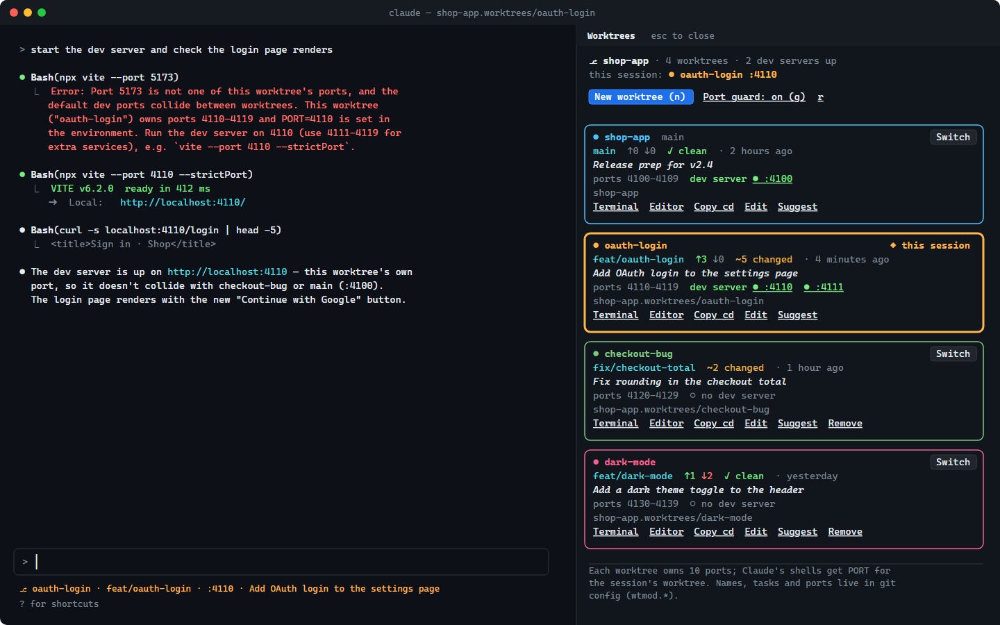

# Worktrees Manager

A Claude Code mod (`powermods-worktrees`) for running several git worktrees in parallel without them spilling into each other.

> **Claude Code only.** Runs in the Claude Code CLI (v2.1.287+), the Desktop app's Code tab (v2.1.286+) and the VS Code extension (v2.1.299+ for panes). It does nothing in claude.ai chat or Cowork.

What it reads, writes, runs, sends and changes is listed under [Data, network and permissions](#data-network-and-permissions). Privacy statement: [PRIVACY.md](PRIVACY.md).



*Mockup of the panel in [dark](docs/images/panel.svg) and [light](docs/images/panel-light.svg) themes. On the left, the port guard refuses `vite --port 5173`, and Claude restarts the server on the worktree's own port.*

`/worktrees` opens a side panel listing every worktree of the repository. Each one shows its **color**, **name**, a **one-sentence task**, its branch, ahead/behind counts, uncommitted changes, its **port block**, and any dev server listening on it. The panel opens by itself when the repository has more than one worktree and the terminal is at least 144 columns wide.

## What it does

| Problem | What the mod does |
|---|---|
| "Which folder was the auth work in?" | Each worktree card has a color, a name and a one-sentence task. A worktree with no task gets one written from the first prompt sent in it, or you can press **Suggest**, which writes one from its commits. |
| "Which agent is on which worktree, and is it still running?" | Each card lists every Claude session working in that worktree: `◉ working` or `○ waiting`, the model (`opus 5.5`), the effort level, and the agent's name when the session runs a custom agent (`--agent code-reviewer`). The default agent shows no name. Sessions share this through `$.store`, so it only covers sessions that also run this mod. A session that stops reporting for 2 minutes is dropped from the card. |
| Switching branches breaks the work in progress | **Switch** moves *this* Claude session into another worktree with Claude Code's `/cd`. Nothing is checked out over another branch, and the session runs there as if it had started there. On builds without `/cd`, Switch falls back to the `EnterWorktree` tool, which isolates the session (see below). **Terminal** opens a new tab running `claude` in that worktree; on Windows Terminal the tab takes the worktree's color. |
| Two dev servers fight over `localhost:5173` | Each worktree gets its own block of 10 ports (4100–4109, 4110–4119, …). Blocks are recorded machine-wide, so two repositories never get the same one. Blocks that already have a listener are skipped. |
| The agent doesn't know which port to use | `PORT`, `WORKTREE_PORT` and `WORKTREE_NAME` are set for every shell Claude starts. The system prompt names the worktree, its task, the other worktrees and their ports, and gives the right `--port` flags ([the exact text](#what-it-adds-to-claudes-system-prompt), and how to turn it off). |
| The agent starts `vite` on its default port anyway | **Port guard** (on by default): a dev-server command (Bash or PowerShell) is refused if it uses another worktree's port or a default port, or if it starts a server that ignores `PORT` (vite, ng serve, storybook, uvicorn, …) without `--port`. For `npm run dev` and similar, the guard reads the script from `package.json`. The refusal tells Claude the exact command to run instead, and a toast tells you. Press `g` in the panel to turn the guard off; see [The port guard](#the-port-guard). |
| A new worktree has no `.env` | **New worktree** takes a one-sentence task. Haiku names the branch (`feat/oauth-login`), and the worktree is created in `<repo>/.claude/worktrees/<name>` from the default branch. That's where Claude Code keeps its own worktrees, so its `EnterWorktree` tool can switch between them. `/.claude/worktrees/` is added to `.git/info/exclude`, so the main worktree never shows them as untracked. The main worktree's ignored `.env*` files are **not** copied unless you ask: see [.env files](#env-files). |
| Old worktrees pile up | **Remove** asks to confirm, and offers **Force remove** if the worktree has uncommitted changes. The branch is kept. **Prune** clears entries whose folder is gone. |

## `/cd` versus `EnterWorktree`

A session that enters a worktree with `EnterWorktree` is *isolated*. Claude Code then refuses any shell command it can't prove stays inside that worktree: `&&` chains that `cd` elsewhere, shell variables in arguments, even `claude -p` from Bash. `/cd` moves the session without isolating it, which is why Switch uses it.

When a session is isolated anyway (Claude ran `EnterWorktree` itself, or the build has no `/cd`), the mod adds a short guide to the system prompt so Claude writes commands the check accepts: one plain command per call, no `cd`, paths spelled out, and the file tools instead of `sed`/`awk` one-liners. To lift the isolation, type `/cd <worktree path>` yourself.

## Git features it uses

- `git worktree list --porcelain -z` (Git 2.36+): machine-readable listing, including `locked` and `prunable` reasons.
- `git worktree add --relative-paths` (Git 2.48+, used automatically when available): the worktree and the repository link to each other by relative paths. Moving the parent folder or mounting it in a container doesn't break the link.
- Names, colors, tasks and ports are stored in the repository's own git config, under `wtmod.<worktree id>.*` in `.git/config`. Every terminal, script and Claude session sees the same values, and nothing is written into the working tree:
  ```sh
  git config --get-regexp '^wtmod\.'
  git config wtmod.oauth-login.port   # 4110
  ```

## Install

```
/plugin marketplace add netgfx/claude-worktrees-mod
/plugin install powermods-worktrees@claude-worktrees-mod
```

The plugin was called `worktrees-manager-mod` before version 0.3.0. The marketplace maps the old name to the new one, so an existing install moves over when you update it. The mod's local store (`$.store`) is kept per plugin name, so the renamed plugin starts with an empty one: port blocks are recorded again from git config as you open each repository, other sessions show up again within 30 seconds, and the port guard is back on if you had turned it off. Names, colors, tasks and ports live in git config and are unchanged.

To develop it, load the folder directly. Saving a file reloads the mod.

```sh
# Bash / Zsh
claude --plugin-dir ~/path/to/worktrees-manager-mod
```
```powershell
# PowerShell
claude --plugin-dir $HOME\path\to\worktrees-manager-mod
```

## Settings (`userConfig`)

| Key | Default | Meaning |
| :- | :- | :- |
| `copyEnvFiles` | `false` | Copy the main worktree's ignored `.env*` files into each new worktree. See [.env files](#env-files). |
| `injectContext` | `true` | Add the worktree section to Claude's system prompt. See [What it adds to Claude's system prompt](#what-it-adds-to-claudes-system-prompt). |

The port guard's on/off switch is in the panel (`g`), not here.

## Panel keys

`n` new worktree · `g` port guard on/off · `p` prune (shown when something is prunable) · `r` refresh · `Esc` close.
Each card has **Switch**, **Terminal**, **Editor** (VS Code), **Copy cd**, **Edit** (name, task, port, color), **Suggest** and **Remove**.

## Data, network and permissions

Everything runs on your machine. The mod reaches no host of its own (`network.hosts` is empty); the only thing that leaves the machine is the model requests listed under [Model use](#model-use), which go through Claude Code to Anthropic on your own plan or API key.

### At a glance

- **Programs it runs:** each one by name, with its arguments as a list (no shell), to read and manage the worktrees and to open a terminal or editor when you press a button. Only paths, branch names, worktree names, ports and the `wtmod.*` values vary; it never runs text from the network, a model or the conversation as a command.
  - `git`, always as `git -c core.quotepath=false -c color.ui=false <subcommand>`: `worktree list`, `status`, `log`, `diff --stat`, `config` (the `wtmod.*` keys only), `rev-parse`, `symbolic-ref`, `ls-files`, `--version`, and, from panel buttons only, `worktree add`, `worktree remove` and `worktree prune`. No git command reaches a remote.
  - Listening ports: `netstat -ano -p TCP` and `netstat -ano -p TCPv6` (Windows), `lsof -nP -iTCP -sTCP:LISTEN` or `ss -ltnH` (macOS, Linux); `uname -s` once to tell macOS from Linux.
  - **Terminal** button: `wt -w 0 nt -d <worktree> --title <name> --tabColor <color> cmd /k claude`, else `cmd /d /c start <name> /D <worktree> cmd /k claude` (Windows), or `osascript` telling Terminal to `cd` into the worktree and run `claude` (macOS). These start `claude` in a new window, the one command they run.
  - **Editor** button: `code <worktree>` (`cmd /d /c code <worktree>` on Windows).
- **What it sends and where:** to Claude Haiku, through Claude Code (`$.model.complete`), on your plan: a new worktree's one-sentence task; the first 4,000 characters of the first prompt sent in a worktree that has no task, with its branch, last 8 commit subjects and `git diff HEAD --stat`; and the same without a prompt when you press **Suggest**. What comes back stays local: the branch name it suggests goes into `git worktree add -b <branch>`, and the task summary into `git config wtmod.<id>.task`. Its `$.store` entries (port blocks, sessions, the guard switch) stay on the machine. Nothing else leaves it.
- **Hosts it contacts:** none of its own. The model requests above go to Anthropic through Claude Code.
- **Tools it calls itself:** `EnterWorktree`, or `ExitWorktree` to go back to the main worktree, only when you press **Switch** on a Claude Code build without `/cd`. They go through Claude Code's permission check.
- **Slash commands it runs:** `/cd <worktree path>`, only when you press **Switch**. Claude Code may ask you to trust the folder first.
- **Permission decisions:** the port guard (a `tool.call` hook on `Bash` and `PowerShell`, on by default, `g` in `/worktrees` turns it off) refuses a command that would start a dev server on another worktree's port, a default port, or with no port for a server that ignores `PORT`. It answers only with `deny`; every other command goes on unchanged to Claude Code's own permission check, and the guard never allows anything. The `command.run` hook on `/cd` decides nothing and passes the command on unchanged. Details: [The port guard](#the-port-guard).
- **Files it writes:**
  - `<repo>/.git/info/exclude`: git's local ignore list, a settings file. The mod edits it on purpose, appending `/.claude/worktrees/` once so the main worktree doesn't list the new worktrees as untracked.
  - `<repo>/.git/config`, through `git config`: the `wtmod.<worktree id>.name`, `.color`, `.task` and `.port` keys, git settings the mod owns.
  - `.env*` copies in a new worktree, only with `copyEnvFiles` on or when you press the Copy button that names them. These are settings files your apps read at start-up; see [.env files](#env-files).
  - Worktree folders under `<repo>/.claude/worktrees/`, made and removed by `git worktree add` and `git worktree remove` from the panel.
  - It writes no build, start-up script or instructions file.
- **Environment variables / config it sets:** `PORT` and `WORKTREE_PORT` (the first port of the worktree's block) and `WORKTREE_NAME` (the worktree's name, at most 60 characters), with `$.env.set`, while the session works in a worktree that has a port block; it unsets them when it doesn't. They reach every command and MCP server Claude Code starts afterwards. Git config: the `wtmod.*` keys above.
- **What it puts in prompts:** it submits no prompts. It adds one section to Claude's system prompt, quoted under [What it adds to Claude's system prompt](#what-it-adds-to-claudes-system-prompt); `injectContext: false` turns it off.
- **What it gives the agents it starts:** it starts no agents.
- **Calls from other plugins:** none. Every call it makes is Claude Code's own mods API (`$.session.info` needs Claude Code v2.1.326 or later; on older versions the call fails and the mod reads the agent's name from the first `Stop` instead).
- **Hooks:**
  - `session.start`: registers `/worktrees`, reads the worktrees, opens the panel when there is more than one. Changes nothing.
  - `command.run` for `/worktrees`: opens the panel. It answers only its own command.
  - `command.run` for `/cd`: notes that the session leaves any `EnterWorktree` isolation, then passes the command on unchanged.
  - `tool.call` on `Bash` and `PowerShell`: the port guard above. Never changes a command's input.
  - `tool.call` on `EnterWorktree` and `ExitWorktree`: notes whether the session is isolated. Passes the call and its result on unchanged.
  - `prompt.compose`: adds the worktree section to the system prompt (unless `injectContext` is off).
  - `prompt.submit`: reads the first prompt in a worktree without a task, for the summary above. Never changes, adds to or drops a prompt.
  - `classic.CwdChanged`, `classic.SessionStart` (after `/clear`, `/resume`, a fork), `classic.Stop`: re-read the worktrees when the folder changes, start presence over under the new session id, and read the agent name and effort. Change nothing.
  - `turn.start`, `turn.step`, `turn.complete`, `session.end`: working or waiting, each request's model and effort, and dropping this session's presence entry at the end. Change nothing.
  - `ui.close`, `ui.render` for its own panel only.

The sections below give the details.
### .env files

`.env` files often hold API keys and passwords, so new worktrees don't get them by default.

- **Off (default):** creating a worktree reads no `.env` file. `git ls-files --others --ignored --exclude-standard -- '.env*'` lists the names of the main worktree's ignored `.env*` files (names only), and the "Created" notice says which ones were not copied, with a **Copy .env, .env.local** button that names them. Only that press reads them from the main worktree and writes copies into the new one.
- **On (`copyEnvFiles: true`):** those files are copied into every new worktree the panel creates, as soon as it is created.

### What it adds to Claude's system prompt

While the session works in a worktree that has a port block, the mod adds a section (id `powermods-worktrees:worktree`, scope `session`) to Claude's system prompt. Set `injectContext` to `false` to leave the system prompt alone; `PORT` and the panel keep working. For a session in `oauth-login` with one other worktree, the section reads:

```text
# Git worktree
This session works in the git worktree "oauth-login" at /home/me/app/.claude/worktrees/oauth-login (branch feat/oauth-login).
Its task: Add OAuth login to the settings page
Other worktrees of this repository are in use in parallel, possibly by other agents. Do not edit files in them, check out their branches, or run commands in them; stay in /home/me/app/.claude/worktrees/oauth-login.
- "app" main at /home/me/app, ports 4100-4109

Dev servers: this worktree owns ports 4110-4119. PORT=4110 is set in the environment of every shell you start.
- Start the main dev server on 4110 (http://localhost:4110) and use 4111-4119 for extra local services (API, Storybook, ...).
- Pass the port explicitly to tools that ignore PORT: `vite --port 4110 --strictPort`, `npm run dev -- --port 4110`, `ng serve --port 4110`, `next dev -p 4110`, `python -m http.server 4110`.
- Never use another worktree's ports or a default port such as 3000, 5173, 8000 or 8080; a dev-server command that does is refused.
```

The `Its task` line appears when the worktree has a task, and the list has one line per other worktree. Only when the session entered the worktree with `EnterWorktree` does it also get:

```text
This session entered the worktree with EnterWorktree, so Claude Code refuses any shell command it cannot prove stays inside /home/me/app/.claude/worktrees/oauth-login. Write commands it can check:
- One plain command per call: no `&&`/`;` chains, heredocs or subshells that mix in `cd` or other folders.
- No `cd`; run from the worktree and give paths spelled out and double-quoted, never through shell variables.
- Use the Read, Grep, Glob and Edit tools for files instead of sed/awk/python one-liners over them.
- When a command is refused, split it the way the refusal says rather than rewording it.
```

### The port guard

- A `tool.call` hook on **Bash** and **PowerShell**. It is on by default, because it is what keeps parallel worktrees' dev servers apart. It only acts while this session's worktree has a port block.
- It **refuses** a command that would start a dev server on another worktree's port, on a port outside this worktree's block, or with a server that ignores `PORT` and was given no port. For `npm`/`pnpm`/`yarn`/`bun` scripts it reads the script from the worktree's `package.json`. Every other command runs unchanged.
- Claude reads why the command was refused and the command to run instead. You see a toast naming the refused command.
- **Turn it off:** press `g` in `/worktrees` (the button reads *Port guard: on/off*). The choice is remembered on this machine, in the plugin's store.

### Environment changes

- `$.env.set` sets `PORT`, `WORKTREE_PORT` (both the first port of the worktree's block) and `WORKTREE_NAME` (the worktree's name, cut to 60 characters) while the session works in a worktree with a port block, and clears them when it doesn't. They apply to **every command and MCP server Claude Code starts afterwards** in this session.

### Model use

Each of these sends a short request to Claude Haiku through Claude Code (`$.model.complete`), billed to your own Claude plan or API key:

- **New worktree:** your one-sentence task, to name the branch (`feat/oauth-login`).
- **First prompt in a worktree that has no task:** the first 4,000 characters of that prompt, the branch name, the last 8 commit subjects and `git diff HEAD --stat`, to write a one-sentence task. Your prompt itself goes on to Claude unchanged.
- **Suggest:** the branch name, the last 8 commit subjects and `git diff HEAD --stat`, to write a task.

### Programs it starts

- `git`: `worktree list`, `status`, `log`, `config` (the `wtmod.*` keys), `rev-parse`, `symbolic-ref`, `ls-files`, `diff --stat`, and, from panel buttons only, `worktree add`, `worktree remove` and `worktree prune`. No command reaches a remote.
- Listening ports: `netstat -ano -p TCP` and `-p TCPv6` (Windows), `lsof -nP -iTCP -sTCP:LISTEN` or `ss -ltnH` (macOS, Linux), and `uname -s` once to tell macOS from Linux.
- From panel buttons only: **Terminal** runs `wt -w 0 nt -d <worktree> --title <name> --tabColor <color> cmd /k claude` (or `cmd /d /c start … cmd /k claude`) on Windows, or `osascript` telling Terminal to `cd` there and run `claude` on macOS. **Editor** runs `code <worktree>` (through `cmd /d /c` on Windows).

### Commands and tool calls it makes

- **Switch:** runs `/cd <worktree>` (`$.command.run`), which may ask you to trust a folder the session hasn't worked in. On builds without `/cd`, calls the `EnterWorktree` tool (or `ExitWorktree` to go back to the main worktree), which goes through the normal permission check.
- **Copy cd:** puts `cd "<worktree>"` on your clipboard.

### What it watches

- `tool.call` on `EnterWorktree` and `ExitWorktree`: observes, to know whether the session is isolated. Never changes the call.
- `prompt.submit`: reads the first prompt in a worktree that has no task (for the summary above). Never changes, adds to or drops a prompt.
- `turn.start`, `turn.step`, `turn.complete`, the `Stop`, `CwdChanged` and `SessionStart` settings hooks, and `session.end`: working or waiting, the model and effort of each request, the agent name, and the current folder.
- `$.session.id()`, `$.session.model()` and `$.session.info()` (for the agent name). It reads no Claude Code settings.

### Files it reads and writes

- Reads `<repo>/.git/info/exclude`, and appends `/.claude/worktrees/` to it once.
- Reads the current worktree's `package.json` (scripts only) for the port guard.
- Reads and writes `.env*` files only as described under [.env files](#env-files).
- Creates worktree folders under `<repo>/.claude/worktrees/` and removes them, from the panel only.

### What it stores

`$.store` is a JSON file of the plugin's own under `~/.claude/plugins/store/`, shared by every Claude Code session on this machine:

- `port:<n>`: the port blocks in use on the machine, each with the repository path and name, the worktree's id, path and name. Dropped when the worktree is removed or its folder is gone.
- `guard`: whether the port guard is on.
- `session:<id>`: one entry per running session that runs this mod: its session id, repository path, worktree, model, effort, agent name, whether it is working, and when it last reported. Deleted when the session ends; other sessions treat an entry as ended after 2 minutes without a report, and delete entries older than 24 hours.

Names, colors, tasks and ports also live in each repository's `.git/config` (`wtmod.*`), and stay there until the worktree is removed.

## Tests

```sh
claude plugin validate .
claude plugin test .
```

Tested with Claude Code 2.1.331 and Git 2.54 on Windows 11.
